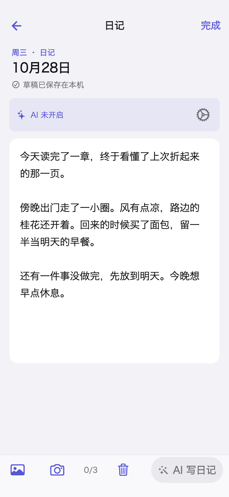
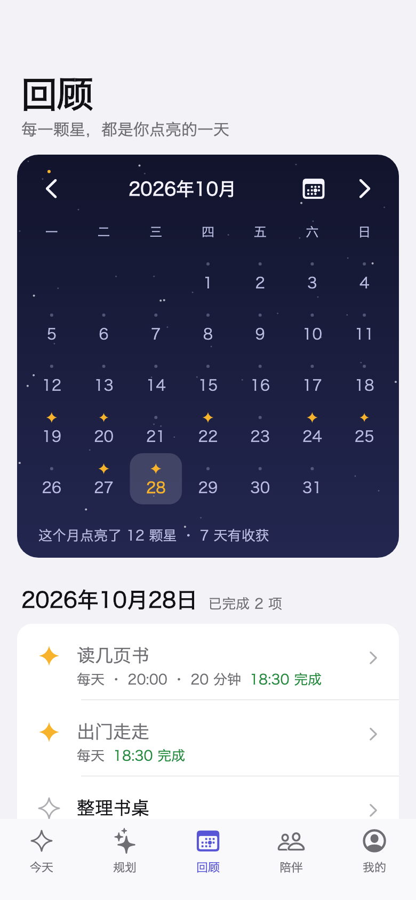

<div align="center">

# 星愿

**把想做的事，一点点变成生活。**

个人目标 · 日常打卡 · 随手记与日记 · 可选的私密陪伴

iOS 优先 / Flutter + Dart / 本地使用无需登录 / MIT

[开始使用](#开始使用) · [开发指南](docs/development.md) · [参与改进](CONTRIBUTING.md) · [安全说明](SECURITY.md)

</div>

读几页书，出门走走，整理一下书桌。也许不是多大的事，但都是自己认真过的一天。

星愿是一个还在慢慢打磨的个人记录 App。你可以用它安排目标、完成后打卡，
也可以只记下一句话，给今天留一点痕迹。不必先登录，不必找人组队，更不用和谁比较。

## 先看看它

<table>
  <tr>
    <th align="center">安排今天</th>
    <th align="center">记下生活</th>
    <th align="center">回头看看</th>
  </tr>
  <tr>
    <td><a href="docs/images/today.png"></a></td>
    <td><a href="docs/images/diary.png"></a></td>
    <td><a href="docs/images/review.png"></a></td>
  </tr>
  <tr>
    <td align="center">做一件，点亮一颗星。</td>
    <td align="center">不必写得漂亮，先记下来。</td>
    <td align="center">看见走过的路，而不是排名。</td>
  </tr>
</table>

以上是实际 Flutter 页面在测试环境中的渲染，使用虚构目标、日记与内存数据库，
不是设计稿，也不是 iOS 真机截图。未读取私人内容，未调用 AI。点击图片可看大图。
生成方式见[截图说明](docs/screenshots.md)。

## 可以做些什么

### 一个人，也能完整使用

- **把目标放进日常。** 每日习惯、指定星期、单次任务都可以记录；完成后打卡，误点可以撤销当天的完成。
- **提醒由自己决定。** 按目标主动开启个人提醒；不授权通知，也不影响记录。
- **给生活留一点空白。** 随手记适合一句话，日记适合慢慢写。支持照片和本地草稿，不要求每次打卡都写感想。
- **按日期回顾。** 看看那天做过什么、写过什么。没有排行榜，也没有因为别人没完成而扣掉的分数。

### 想有人陪伴时，再打开

代码中也包含自愿配对、选择性分享与文字／图片私聊。彼此可以有完全不同的目标，
加入陪伴不等于公开全部记录，也不能替对方修改或完成目标。

这些联网能力需要配置自己的后端；本仓库不提供开箱即用的公共服务。

### AI 是可选帮手，不是必填项

经授权并主动触发后，AI 可以协助润色文字、整理日记和提出规划建议。
先看预览，再决定是否采用；不把生成内容当作你已经写好或已经完成的记录。

规划 Agent 和部分无障碍体验仍在开发验证中。不开启 AI，也可以照常使用本地目标、随手记与日记。

## 开始使用

**目前发布的是源码，不是 App Store 下载包，也不附带后端账号或模型额度。**
先在隔离的 iOS 模拟器里试用最合适，不要覆盖存有私人数据的已有安装。

开发环境：macOS、Xcode、Flutter **3.47.6**（Dart **3.13.5**）。

```sh
git clone https://github.com/hollegjx/xingyuan.git
cd xingyuan
flutter pub get --enforce-lockfile
flutter devices
flutter run -d <your-ios-simulator-id>
```

把最后一行的设备 ID 换成 `flutter devices` 列出的 iOS 模拟器 ID。
无需配置服务端即可体验个人离线记录；可先建一个“读几页书”的目标，再试试打卡、撤销和日记。

真机运行需要自己的 Apple 开发团队和唯一 Bundle ID。仓库中的 `org.example.xingyuan`
是示例标识，不含签名资料。当前未提供 Android、Web 或桌面端产品。

自建陪伴／AI 服务、子包依赖和测试方法见[开发指南](docs/development.md)。
`config/*.example.json` 是结构示例，`.invalid` 地址故意不可连接，不指向原项目的服务。

## 关于隐私，说清楚几件事

- **个人记录默认私密。** 分享需要主动选择，不因配对而自动公开笔记、其他目标或历史。
- **照片不用于 AI 请求。** 文字发送范围以授权界面和显式操作为准；不把整份私人历史当作默认上下文。
- **本地使用不依赖联网服务。** 开启可选功能前，请确认自建后端和模型提供方的存储、日志与数据处理规则。
- **源码公开，不代表私人资料公开。** 本仓库从独立的脱敏快照开始，不包含原私有 Git 历史、内部协作记录、真实日记、照片或部署凭据。

发现安全问题时，请按[安全说明](SECURITY.md)联系，不要把密钥、备份或私人记录贴进公开 Issue。

## 给想翻翻代码的人

| 目录 | 放了什么 |
| --- | --- |
| `lib/` | Flutter 客户端、页面与本地数据层 |
| `packages/xingyuan_core/` | 共享协议、日历和校验规则 |
| `server/` | 可选陪伴与 AI 后端、设备鉴权 |
| `test/`、`integration_test/` | 合成数据测试与独立 iOS 验证入口 |
| `tool/assistant_eval/`、`tool/agent_eval/` | 默认离线的评测工具 |
| `drift_schemas/` | SQLite / Drift 数据库迁移快照 |
| `supabase/` | 可选云端能力的早期验证材料，不是完整托管服务 |

代码里的 `habit_checkin` 是早期工程名，应用名称是「星愿」。

自动化检查覆盖格式、静态分析、测试、数据库生成与敏感信息扫描。
它们不替代真实模型质量、通知权限、VoiceOver、iOS 模拟器或手机上的实际验收。
本地记录是基础；联网和 Agent 能力请按各自配置与验证状态使用。

## 一起把它磨得顺手一点

不需要带着一个大功能来。一个难懂的按钮、一处大字体下挤在一起的文字，
或者一次没保存成功的经历，都是有用的反馈。

欢迎用虚构内容复现问题，写清操作步骤、预期和实际结果。想改代码可以先看
[贡献指南](CONTRIBUTING.md)；涉及隐私默认值、平台扩展或新增收费服务，请先讨论。

## 许可证

本项目原创代码采用 [MIT License](LICENSE)。依赖、Flutter 模板和占位图标遵循各自的许可证，
详见[第三方声明](THIRD_PARTY_NOTICES.md)。发布自己的成品前，请替换占位品牌素材并检查依赖声明。

---

有些日子做得多一点，有些日子只记下一句话。都可以。
